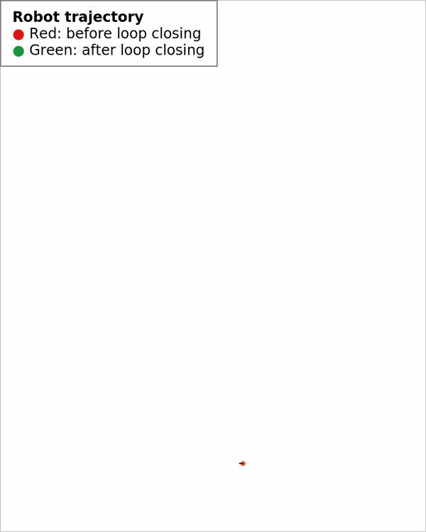

# 2D Pose Graph Optimization

## Introduction

This repository contains a small C++ implementation of 2D pose graph optimization. Robot poses are represented as nodes, while odometry measurements and loop closures are represented as constraints between the nodes. The trajectory is corrected by minimizing the error of all constraints together.

The implementation follows the graph-based SLAM formulation described in [1, 2]. It uses Eigen for the linear algebra and Qt to show the recorded trajectory before and after a loop closure correction.

## Installation

### Dependencies

The project requires a C++17 compiler, CMake, Eigen3 and Qt5. On Ubuntu or Debian they can be installed with:

```
sudo apt update
sudo apt install build-essential cmake libeigen3-dev qtbase5-dev
```

Qt Creator is optional and can be used as an IDE, but it is not required to build or run the example.

### Source Code

The source code is hosted on GitHub: [ShahramKhorshidi/pose_graph_optimization](https://github.com/ShahramKhorshidi/pose_graph_optimization)

```
# Clone pose_graph_optimization
git clone https://github.com/ShahramKhorshidi/pose_graph_optimization.git
cd pose_graph_optimization
```

### Build

```
cmake -S . -B build
cmake --build build --parallel
```

### Quick Start

Run the example from the repository directory:

```
./build/example/RobotVisualization
```

The recorded trajectory was collected from a Toyota Human Support Robot (HSR) moving through a corridor. It contains one loop closing event between nodes 9 and 261. The example shows the odometry trajectory in red, pauses when the loop closure is detected, and then shows the optimized trajectory in green.

The animation speed is controlled by `trajectoryDelayMs` near the beginning of `example/main.cpp`. Its value is the delay between two poses in milliseconds. Increase it to make the robot move slower or decrease it to make the robot move faster. `loopClosingPauseMs` controls how long the animation stops when the loop closure is detected.

<p align="center">
  
</p>

## Framework

### Code Structure

- `utils/Pose2D` implements 2D pose composition, relative transformations and angle normalization.

- `pose_graph/GraphNode` stores the node ID, the current pose and the initial pose.

- `pose_graph/GraphConstraint` stores the connected node IDs and relative-pose observation, and computes $e_{ij}$, $A_{ij}$ and $B_{ij}$.

- `pose_graph/PoseGraph` adds nodes and constraints, assembles the linear system, fixes the first pose, solves for $\Delta x$, stores the final sparse information matrix and computes node marginal covariances.

- `example/main.cpp` reads the HSR trajectory, inserts the loop closing constraint between nodes 9 and 261, runs the optimization and displays the result.

### Pose Graph

The pose graph contains nodes connected by odometry and loop closing constraints. Each node stores a global 2D robot pose

$$
c_i = \begin{bmatrix} t_i \\ \theta_i \end{bmatrix}
    = \begin{bmatrix} x_i & y_i & \theta_i \end{bmatrix}^{T}.
$$

A constraint $z_{ij}$ describes the measured pose of node $j$ in the coordinate frame of node $i$. The 2D rotation matrix and the predicted relative pose are

$$
R_i =
\begin{bmatrix}
\cos\theta_i & -\sin\theta_i \\
\sin\theta_i & \cos\theta_i
\end{bmatrix},
$$

$$
h_{ij}(c_i,c_j) =
\begin{bmatrix}
R_i^{T}(t_j-t_i) \\
\theta_j-\theta_i
\end{bmatrix}.
$$

The constraint error is

$$
e_{ij} = z_{ij}-h_{ij}(c_i,c_j).
$$

The angular part of the relative pose and its error are normalized to $[-\pi,\pi)$. Odometry constraints connect consecutive poses and their observations are obtained from the initial odometry trajectory. A loop closing constraint connects two poses that observe the same place and introduces an additional measured relative pose.

<p align="center">
  
</p>

### Constraint Covariance

In general, each constraint has a measurement covariance $\Sigma_{ij}$ and the corresponding information matrix

$$
\Omega_{ij}=\Sigma_{ij}^{-1}.
$$

The information matrix determines the weight of a constraint in the total error

$$
F(c) = \sum_{(i,j)} e_{ij}^{T}\Omega_{ij}e_{ij}.
$$

The current implementation uses the same diagonal covariance for all odometry and loop closing constraints:

$$
\Sigma = \mathrm{diag}\left((0.15\,\mathrm{m})^2,
                                   (0.15\,\mathrm{m})^2,
                                   (0.2\,\mathrm{rad})^2\right),
$$

$$
\Omega = \Sigma^{-1}
       = \mathrm{diag}(44.44,44.44,25).
$$

This constraint covariance is defined in `PoseGraph::init()` and represents the uncertainty of a relative-pose measurement. The same numerical matrix is used as the default covariance of a new node, but the stored node covariance and the constraint covariance are separate quantities. Although `GraphConstraint` currently declares an `omega` member, the optimizer assembles the system using the common `PoseGraph::omega`; therefore, constraint-specific covariance is not active in the current implementation.

### Node Pose Covariance

Each `GraphNode` stores a user-supplied $3\times3$ covariance $C_i$ for the pose components $[x_i,y_i,\theta_i]^T$:

$$
C_i =
\begin{bmatrix}
\sigma_{x_i}^{2} & \sigma_{x_i y_i} & \sigma_{x_i\theta_i} \\
\sigma_{x_i y_i} & \sigma_{y_i}^{2} & \sigma_{y_i\theta_i} \\
\sigma_{x_i\theta_i} & \sigma_{y_i\theta_i} & \sigma_{\theta_i}^{2}
\end{bmatrix}.
$$

The diagonal entries contain the variances of $x_i$, $y_i$ and $\theta_i$, while the off-diagonal entries contain their cross-covariances. A covariance can be assigned whenever a node is added:

```cpp
Eigen::Matrix3d nodeCovariance = Eigen::Matrix3d::Zero();
nodeCovariance(0, 0) = 0.10 * 0.10; // x variance in m^2
nodeCovariance(1, 1) = 0.10 * 0.10; // y variance in m^2
nodeCovariance(2, 2) = 0.05 * 0.05; // theta variance in rad^2

poseGraph.addOdomNode(odomPose, nodeCovariance);
```

The prior node accepts a covariance in the same way with `addPriorNode(priorPose, nodeCovariance)` or `PoseGraph poseGraph(priorPose, nodeCovariance)`. When the covariance argument is omitted, as in the example program, the node receives the common default

$$
C_{\mathrm{default}} =
\mathrm{diag}\left((0.15\,\mathrm{m})^2,
                    (0.15\,\mathrm{m})^2,
                    (0.2\,\mathrm{rad})^2\right).
$$

The covariance of an existing node can be changed and read using its node ID:

```cpp
poseGraph.setNodeCovariance(nodeId, nodeCovariance);
Eigen::Matrix3d savedCovariance = poseGraph.getNodeCovariance(nodeId);
```

The stored matrix returned by `getNodeCovariance()` represents covariance supplied by the user or another estimator. It is not changed during graph optimization and does not replace the constraint information matrix $\Omega$.

After optimization, the graph is linearized once more at the final poses. The resulting sparse Hessian is stored as the information matrix $H$ and can be accessed with:

```cpp
const Eigen::SparseMatrix<double>& H = poseGraph.getInformationMatrix();
```

Its rows and columns follow the node order of the most recently optimized interval. After fixing the reference pose, the approximate covariance of that optimized state is

$$
P \approx H^{-1},
$$

and the posterior marginal covariance of node $i$ is the corresponding diagonal block

$$
P_i \approx \left[H^{-1}\right]_{ii}.
$$

The implementation obtains this block with the sparse Cholesky solver instead of constructing a dense inverse. It is stored separately from the user-supplied covariance and can be read after the node has been optimized:

```cpp
Eigen::Matrix3d marginalCovariance =
    poseGraph.getMarginalCovariance(nodeId);
```

Calling `getMarginalCovariance()` for a node that has not yet been included in an optimization throws `std::logic_error`.

### Linearization and Sparse System

The poses being optimized are stacked into one state vector $x$. `GraphConstraint` computes the prediction $h_{ij}$, the error $e_{ij}$, and the two Jacobian blocks of the prediction

$$
A_{ij}=\frac{\partial h_{ij}}{\partial c_i}=
\begin{bmatrix}
-R_i^T & \frac{\partial R_i^T}{\partial\theta_i}(t_j-t_i) \\
0_{1\times2} & -1
\end{bmatrix},
\qquad
B_{ij}=\frac{\partial h_{ij}}{\partial c_j}=
\begin{bmatrix}
R_i^T & 0_{2\times1} \\
0_{1\times2} & 1
\end{bmatrix}.
$$

Since $e_{ij}=z_{ij}-h_{ij}$, the linearized error is

$$
e_{ij}(x+\Delta x) \approx
e_{ij}-A_{ij}\Delta c_i-B_{ij}\Delta c_j.
$$

Each constraint contributes only to four $3\times3$ blocks of the approximate Hessian and two blocks of the right-hand side:

$$
\begin{aligned}
H_{ii} &\mathrel{+}= A_{ij}^{T}\Omega A_{ij}, &
H_{ij} &\mathrel{+}= A_{ij}^{T}\Omega B_{ij}, \\
H_{ji} &\mathrel{+}= B_{ij}^{T}\Omega A_{ij}, &
H_{jj} &\mathrel{+}= B_{ij}^{T}\Omega B_{ij}, \\
b_i &\mathrel{+}= A_{ij}^{T}\Omega e_{ij}, &
b_j &\mathrel{+}= B_{ij}^{T}\Omega e_{ij}.
\end{aligned}
$$

With this Jacobian convention, the code solves

$$
H\Delta x=b, \qquad x\leftarrow x+\Delta x.
$$

The first pose is fixed to remove the global reference-frame ambiguity. Because an edge only involves two poses, most blocks in $H$ are zero. The current implementation fills the required blocks in a dense temporary matrix, converts it to an Eigen sparse matrix, and solves the system using sparse Cholesky factorization. The poses and constraints are updated and relinearized until $\lVert\Delta x\rVert$ is smaller than the tolerance.

## References

[1] G. Grisetti, R. Kümmerle, C. Stachniss and W. Burgard, "A Tutorial on Graph-Based SLAM," IEEE Intelligent Transportation Systems Magazine, 2010. [DOI: 10.1109/MITS.2010.939925](https://doi.org/10.1109/MITS.2010.939925)

[2] K. Konolige, G. Grisetti, R. Kümmerle, W. Burgard, B. Limketkai and R. Vincent, "Efficient Sparse Pose Adjustment for 2D Mapping," IEEE/RSJ International Conference on Intelligent Robots and Systems, 2010. [DOI: 10.1109/IROS.2010.5649043](https://doi.org/10.1109/IROS.2010.5649043)
